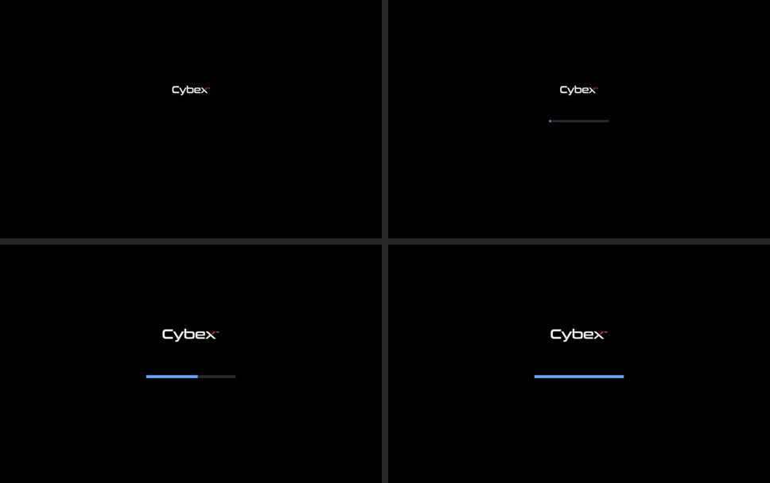

# Testing ISO beta.24: a progress bar from the boot menu to the installer — 2026-10-30

After **Install Cybex OS** was chosen, the screen stayed dark for a long while
before the installer appeared, longest from PXE. The medium now shows its logo
with a progress bar from the start of stage 1 until the installer screen has
drawn ([installation](../installation.md)).

## Cause

Measured in a UEFI QEMU guest, the beta.23 ISO on a virtual CD throttled to
20 MB/s, screenshots every 0.2–0.5 s:

- Plymouth 26 ignores the firmware framebuffer (simpledrm) until its 8-second
  device timeout, unless `plymouth.use-simpledrm` is set. The medium's initrd
  has no GPU driver, so nothing drew during stage 1 and early stage 2. QEMU
  kept GRUB's last picture there; a GPU driver's mode change makes it dark.
  Without a display Plymouth also told systemd to print unit status on tty1.
- The theme showed its bar only after a disk unlock prompt, which the medium
  never shows, and Plymouth's own estimate needs earlier boots.
- Plymouth quit when user sessions were allowed. The installer screen then
  waited for udev and loaded its 19 MB program, about 2 s of black.

Once Plymouth drew on simpledrm, two more faults appeared:

- When stage 2 loaded virtio_gpu, Plymouth opened the new device about 5 ms
  before the kernel's first output probe. It is not that device's DRM master,
  so `GETCONNECTOR` was demoted to a read-only probe (`drm.debug=0x06`) and
  every output read as disconnected. Plymouth retries such a device only on a
  change event, and none came; the splash lost its display.
- A bare `plymouth.debug` streams Plymouth's trace to tty1, which makes fbcon
  take over the console. A tty reset to text mode then repaints a black
  console over the splash. Tests use `plymouth.debug=stream:/run/…` instead.

## Change

- `cybexos-installer` Plymouth variant (`nix/packages/plymouth.nix`): the same
  pictures and script after one line that sets `global.installation_medium`.
  In boot mode it shows the bar from the first frame and follows the medium's
  milestones (unit names confirmed from Plymouth's trace): `sysroot-iso.mount`
  0.25, `sysroot-nix-store.mount` 0.4, `systemd-journal-flush.service` 0.55,
  `NetworkManager.service` 0.7, `cybexos-installerd.service` 0.85, and the
  status `cybexos-installer-ready` 1. Between milestones it eases towards the
  next, halfway after four seconds, never back. Installed systems keep the
  `cybexos` theme unchanged.
- Kernel parameter `plymouth.use-simpledrm` on the medium.
- A udev rule on the medium: when a framebuffer device is added (after the
  kernel's first output probe), it triggers a change event on the DRM minors,
  and Plymouth takes over the native device.
- Handover as with a display manager: `cybexos-installer-splash` waits for
  udev, reports `cybexos-installer-ready`, waits 0.3 s for the bar to fill and
  runs `plymouth deactivate`. The screen's unit is `Type=notify`; the screen
  sends `READY=1` in its second event-loop pass, after its first frame.
  `plymouth-quit` is ordered after it and runs `plymouth quit --retain-splash`.
  Each command of the screen's unit hangs up and resets tty1, so Plymouth is
  driven from other units.
- `nix/tests/plymouth-unlock.nix` no longer sets `boot.initrd.systemd.enable`,
  an option NixOS 26.11 removed; the check did not evaluate before.

## Measured result

Same guest and 20 MB/s medium, seconds after Enter:

| | GRUB loading | No splash | Logo only | Black | Logo + bar | Installer |
|---|---|---|---|---|---|---|
| beta.23 | 0–≈5 | ≈5–15.0 | 15.0–16.5 | 16.5–18.5 | — | 18.5 |
| beta.24 | 0–4.4 | — | — | — | 4.4–19.0 | 19.0 |

beta.24 had no black frame at 0.2 s sampling. Nor had a slim task ISO of the
same change unthrottled at 0.1 s sampling (splash from 1.8 s, installer at
7.2 s). GRUB's loading screen and Plymouth's first frame put the logo on the
same pixels. The bar continued through the switch from simpledrm to
virtio_gpu, and the frame left while the screen starts shows a full bar.

Also on slim task ISOs of the same change: **Install with basic graphics**
(`nomodeset`) kept the splash on simpledrm and handed over at 1920×1080;
**Install in text mode** skipped Plymouth, the splash unit and the screen and
started the text installer; restarting `cybexos-installer-ui.service` (as a
keyboard change does) became active again through `READY=1`. No unit failed.

## Exact source and image

- Version: `1.0.0-beta.24`.
- Built from the working tree on top of `45d45f4b` (the installer's include
  icons, not yet in an ISO) before this change was committed, so the ISO
  reports revision `uncommitted`.
- Source NAR: `sha256-jOqiNMiMgrDvlXD8BVcTl8De0jY1Dv2AJGkSMwJzvck=`.
- ISO SHA-256: `f4f159074fa2efcfeb2954f42aa2e08bb8b9fd3c0b29db2fbba059b06a887f65`.
- ISO size: 7,319,273,472 bytes (6.817 GiB).

This record and its picture were written after the image was built; they are
not part of its source NAR. `flake.lock` and `system.stateVersion` are
unchanged.

## Checks

- Builds: the ISO, its `installer-ui` (the kiosk's 46 Rust tests) and
  `checks.x86_64-linux.parity`, which now also asserts the medium's theme
  variant, `plymouth.use-simpledrm`, `Type=notify` and the quit ordering.
- `checks.x86_64-linux.plymouth-unlock` passed through `agent-resource`: the
  installed theme's disk unlock with Wiz is unchanged and shows no bar first.
- `scripts/check-image-parity`: all 41 completed-image/source checks passed.

## Installation and staged-updater verification

`scripts/qualify-installations --case both --scenario lifecycle --interactive`
passed for plain and encrypted installations in 31 minutes: all 18
milestones and 10 lifecycle scenarios each (56 results, none failed). Each
case booted this ISO and installed through the real tty1 screen with
keyboard and pointer input. That exercised the `Type=notify` screen and the
splash handover on every medium boot. The run used supervised
`agent-resource` lease `e05fc9c6db4647c9a17e85d04a737c32` with a CI
reservation of 26 GiB and eight CPUs.

Not exercised: physical hardware (amdgpu, i915/xe, nouveau and NVIDIA), a
real PXE boot through iVentoy, Secure Boot, and HiDPI or rotated panels. The
simpledrm-to-native handover was seen only with virtio_gpu.

## PXE delivery

After qualification, beta.24 was copied to a task staging directory on the
same filesystem, hashed against the build, and moved into `/data/pxe/iso`,
where its checksum verified. beta.23 and its checksum were removed
(7,319,273,472 plus 92 bytes); no other operating system's image changed.
`refresh_img_list` returned `result: success` and `get_img_tree` listed only
beta.24, but `get_img_summary` kept a stale count of 2. After
`sudo systemctl restart iventoy.service`, `query_status` reported `running`,
`get_img_tree` listed only beta.24 (image 1), `get_img_summary` reported
`count: 1`, and `iventoy.service` was `active`.
