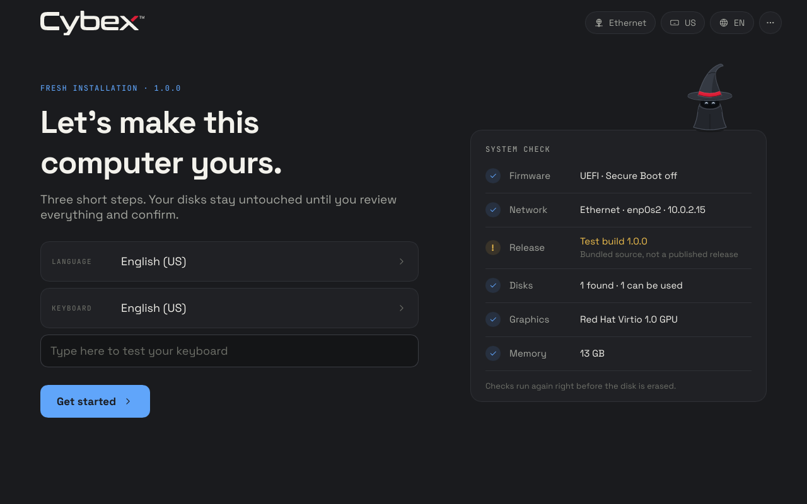

# Testing ISO beta.25: no beta tag in the installer, and the pointer picker — 2026-10-30

The installation medium no longer shows the prerelease suffix or the channel
([installation](../installation.md)). The boot menu reads
`Cybex OS Installer · 1.0.0`, the legacy BIOS notice `Cybex OS 1.0.0`, and the
graphical installer `Fresh installation · 1.0.0`, `Test build 1.0.0`,
`Cybex OS 1.0.0` and `Cybex OS 1.0.0 is installed on …`. The text-mode
installer's release line drops `• beta channel •`, and the system check's
release detail is the exact revision instead of the channel. The ISO name,
`/etc/cybexos/release.json`, the update channel (`beta`) and the installed
system, including its boot menu entry, keep `1.0.0-beta.25`.

This is also the first ISO with Settings → Appearance → Pointer (`c9873258`,
merged into `main` as `472f3596`).

## Exact source and image

- Version: `1.0.0-beta.25`.
- Image and installed-source revision:
  `8c507ed57dbc8d3de4c506852747962b15bade95` on `main`, built from a clean
  tree, so the ISO and installed systems report it.
- Source NAR: `sha256-PDFDS+aClPEOCkO9OGDqDlt3lJBvFN/GxvvCd47Nz8Q=`.
- Nixpkgs: `nixos-unstable` at `31ecbaca1bdefa45dffc409f0250bd8039ea0010`,
  unchanged; `system.stateVersion` is unchanged.
- ISO SHA-256: `cf213c6691adf97af1e1e037b526a763a5ff641f666026787f32076149010c66`.
- ISO size: 7,319,273,472 bytes (6.817 GiB).
- Served ISO: `/data/pxe/iso/cybexos-1.0.0-beta.25.iso` with
  `cybexos-1.0.0-beta.25.iso.sha256` (92 bytes).

This record and its picture were written after the image was built; they are
not part of its source NAR.

## Checks

- `nix develop -c tests/run`: 806 Python and 1,563 Node tests (1,546 passed,
  17 skipped) and the other suites passed.
- Builds: the ISO, `installer-ui` (the kiosk's Rust tests), the boot theme
  (its installer heading and BIOS notice rendered `1.0.0`) and
  `checks.x86_64-linux.parity`.
- Pre-flight: real Hyprland `--verify-config` on the installer payload's
  system (`lifecycle/cybexos/desktop_check.verify_compositor`) passed.
- `scripts/check-image-parity` against `8c507ed5`: all 41 image/source checks
  passed.

## Installation and staged-updater verification

`scripts/qualify-installations --interactive --applications standard --case both --scenario lifecycle`
passed for plain and encrypted installations in 28 minutes. Each case booted
this ISO, installed through the real tty1 screen with keyboard and pointer
input, matched the ISO's release identity (`8c507ed5`, the NAR above), and
passed all 17 checked milestones (plus the measured prebuilt store transfer,
3,370 and 3,365 paths in about 74 s) and all 10 lifecycle scenarios. The
installed boot menu check confirmed the entry `Cybex OS 1.0.0-beta.25`. The
run used `agent-resource` lease `9ed7bc41312043e888da5c806df9e9f6`, which
closed with no remaining resources.

Not exercised: physical hardware, a real PXE boot through iVentoy and Secure
Boot. The pointer picker's VM check (`checks.x86_64-linux.pointer`) ran on
its branch before the merge, not on this revision.

## PXE delivery

After qualification, beta.25 was copied to a task staging directory on the
same filesystem, hashed against the build, and moved into `/data/pxe/iso`,
where its checksum verified. beta.24 and its checksum were removed
(7,319,273,472 plus 92 bytes); no other operating system's image changed.
`refresh_img_list` returned `result: success` and `get_img_tree` listed only
beta.25, but `get_img_summary` kept a stale count of 2. After
`sudo systemctl restart iventoy.service`, `query_status` reported `running`,
`get_img_tree` listed only beta.25 (image 1), `get_img_summary` reported
`count: 1`, and `iventoy.service` was `active`.
